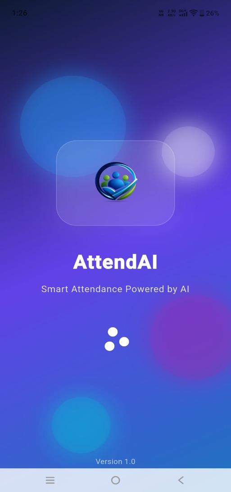
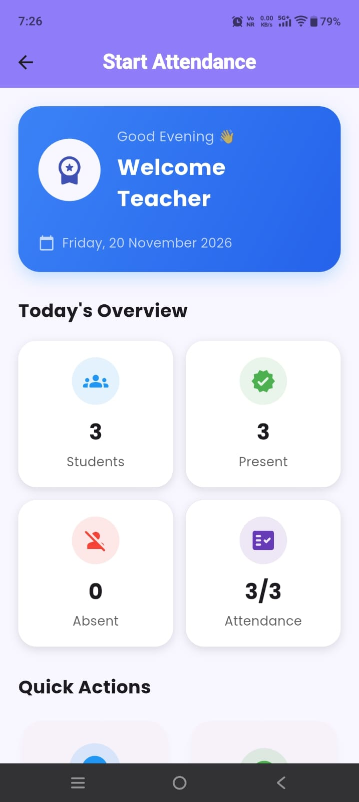
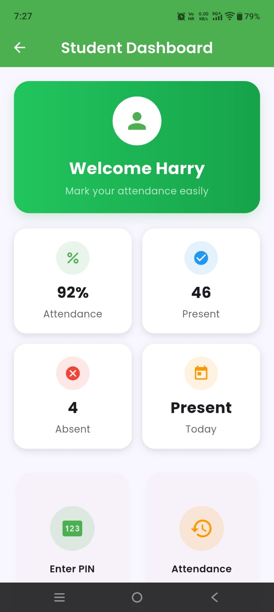
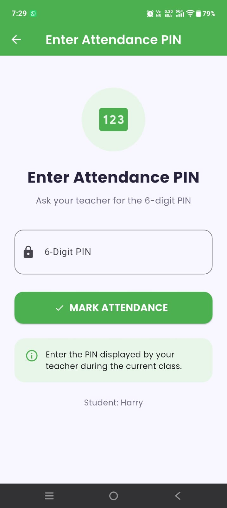
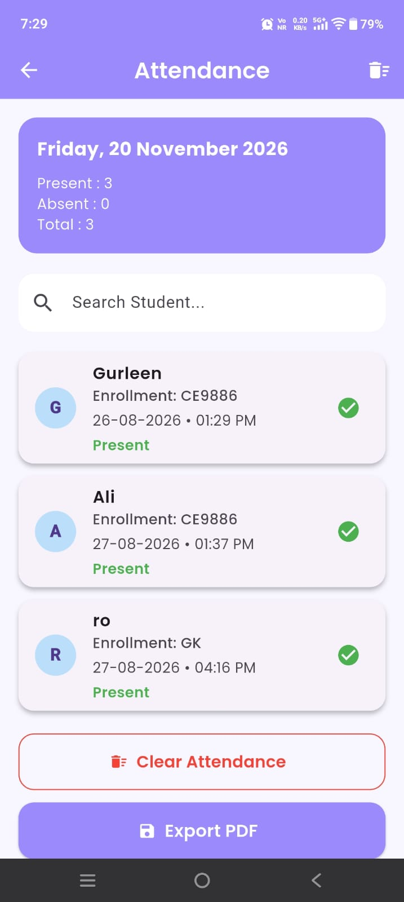

# AttendAI – Smart Attendance Management System

AttendAI is a Flutter-based Smart Attendance Management System designed to simplify and digitize classroom attendance.

## Features

- Separate Teacher and Student Login
- Six-digit PIN-based attendance system
- Period-wise attendance management
- Attendance tracking
- Teacher and Student dashboards
- User-friendly interface

## Technology Stack

- Flutter
- Dart
- Android Studio
- Visual Studio Code

## Project Structure

- lib/ – Application source code
- android/ – Android platform files
- ios/ – iOS platform files
- assets/ – Application assets
- test/ – Testing files

## How to Run

1. Clone this repository.
2. Open the project in VS Code.
3. Run `flutter pub get`.
4. Run `flutter run`.

---

## 📱 Application Screenshots

### 1. Splash Screen

### 2. Role Selection

### 3. Teacher Dashboard

### 4. Student Dashboard

### 5. Attendance PIN

### 6. Attendance Records

## Developer

Gurleen Kaur Dhillon

B.Tech CSE (AI)
